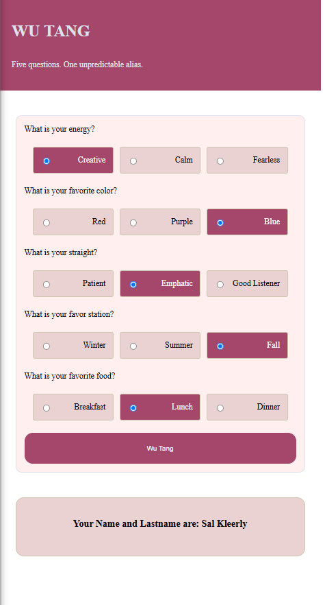

# 🎤 Project: Wu-Tang Name Generator

### Goal: Create a Wu-Tang Clan name generator. Present the user with 5 survey questions and based on those answers randomly generate their name. The name doesn't have to be exact names, but Wu-Tang sounding-ish names. Ex: Childish Gambino (who actually got his name from a Wu-Tang name generator).

### Screen

### How it works
A browser-based personality quiz that generates a randomized Wu-Tang-inspired alias based on the user’s answers. Players answer five multiple-choice questions, and the application identifies the answer category selected most often to generate a matching first and last name.

### Features
- Displays a five-question personality quiz.
- Includes three radio-button answers for each question.
- Validates that the user selects an answer for every question.
- Generates a randomized first and last name based on the winning category.
- Returns the generated name as JSON.
- The generated Wu-Tang name and lastname appears on the page.

### Technologies Used
- HTML5 
- CSS3 
- JavaScript (ES6)
- Node.js
- Figlet library for Node.js
- Not external API used: the generated aliases come from hard coded JS objects insider server.js 

### Instalation
- git clone https://github.com/YOUR-USERNAME/wu-tang-name-generator.git
- cd wu-tang-name-generator
- npm install
- npm install figlet
- node server.js
- http://localhost:8000

### Future Improvements
- Add more personality questions and additional answer categories.
- Add a restart button to reset the quiz and generate a new result.
- Add a share button for copying or sharing the generated name.

**live demo**

https://wu-tang-generator-34hu.onrender.com